# Awesome Dedicated Threat Hunting Services 🛡️🔍

<p align="center">
  
</p>

<p align="center">
  <a href="https://github.com/ishandutta2007/Awesome-Awesome-Awesome"></a><a href="https://discord.gg/jc4xtF58Ve"></a>
  <a href="https://github.com/ishandutta2007/Awesome-Dedicated-Threat-Hunting-Services/stargazers"></a>
  <a href="https://github.com/ishandutta2007/Awesome-Dedicated-Threat-Hunting-Services/network/members"></a>
  <a href="https://github.com/ishandutta2007/Awesome-Dedicated-Threat-Hunting-Services/issues"></a>
  <a href="https://github.com/ishandutta2007/Awesome-Dedicated-Threat-Hunting-Services/blob/main/LICENSE"></a>
  <a href="https://github.com/ishandutta2007"></a>
</p>

---

## 🌟 Overview & Mission

**Top Dedicated Threat Hunting Services & Frameworks (Commercial SaaS & Open-Source) 🌟 Star if you find it helpful! 🌟**

A curated and comprehensive index of enterprise **Managed Detection and Response (MDR)** providers, **24/7 Managed SOC Services**, **Adversary-Focused Threat Intelligence**, and **Open-Source Threat Hunting Tools** for proactive cyber defense, endpoint interrogation, detection engineering, and incident response.

> **Last updated**: November 2026

This directory bridges the gap between commercial hunting powerhouses and self-hosted open-source detection engineering workbenches. Whether you are an enterprise CISO evaluating human-led 24/7 SOC augmentation or a blue team security engineer constructing an internal hunting pipeline with portable rules and endpoint query languages, this list details verified telemetry capabilities, pricing structures, trial terms, and architectural trade-offs.

---

## 📑 Table of Contents

- [📊 Sector Overview & Market Dynamics](#-sector-overview--market-dynamics)
- [🏢 SaaS & Hosted Commercial Platforms](#-saas--hosted-commercial-platforms)
- [💻 Open-Source GitHub Projects](#-open-source-github-projects)
- [🤝 How to Contribute](#-how-to-contribute)
- [☕ Support & Community](#-support--community)
- [📈 Star History](#-star-history)
- [⚠️ Disclaimer](#️-disclaimer)

---

## 📊 Sector Overview & Market Dynamics

The global dedicated threat hunting and Managed Detection & Response (MDR) market is estimated at **$4.6B–$5.7B** for specialized threat hunting solutions and **$6.2B–$11.2B** when encompassing broader MDR platforms in 2026, compounding at an annual growth rate (CAGR) of **15% to 23%**. Rather than a winner-take-all monopoly, the sector remains **moderately to highly fragmented** and fiercely competitive, split among platform EDR giants (CrowdStrike, SentinelOne), pure-play concierge MDR providers (Arctic Wolf, eSentire), global incident response consultancies (Mandiant/Google Cloud, Kroll), and regional SOC service providers catering to diverse enterprise toolchains and local data-sovereignty mandates.

---

## 🏢 SaaS & Hosted Commercial Platforms

*Sorted in descending order by company valuation / market capitalization.*

| Platform / Service | Company Size (Valuation / Revenue) 📈 | Pricing 💰 | Free Tier / Trial Limit ⏱️ | Key Focus & Trade-offs ⚖️ |
| :--- | :--- | :--- | :--- | :--- |
| **[CrowdStrike Falcon OverWatch Elite](https://www.crowdstrike.com/services/falcon-overwatch/)** | **~$80B–$95B Market Cap** (NASDAQ: CRWD; ~$4B+ ARR) | Starting at **$59.99/endpoint/year** (Falcon Pro entry base) up to **$180–$250+/endpoint/year** with OverWatch managed hunting & threat intel modules; custom enterprise contracts | **15-day free trial** of Falcon platform (no credit card required; OverWatch human hunting evaluation via sales PoC) | Elite managed threat hunting with proprietary telemetry. *Trade-off*: Premium pricing; Elite hunting tier requires existing Falcon agent and Falcon Adversary Intelligence Premium. |
| **[SentinelOne Vigilance Respond Pro](https://www.sentinelone.com/global-services/vigilance-respond/)** | **~$8.5B Market Cap** (NYSE: S; ~$700M+ ARR) | Starting at **$45–$60/endpoint/year** (Singularity Core base) up to **$17,115.99/bundle** (Singularity Platform Pro / Vigilance upgrade tier per CDW listings) | **30-to-90-day PoC evaluation** with dedicated sales engineering support (no permanent free tier) | MDR with DFIR and incident response retainer hours. *Trade-off*: Vigilance Respond Pro SKU evolution/transition into Singularity MDR tiers; verify active licensing bundle. |
| **[Mandiant Managed Defense](https://cloud.google.com/mandiant/managed-defense)** | **$5.4B Valuation** (Acquired by Alphabet / Google Cloud; parent market cap ~$2.1T) | Starting at **$53.86/license/year** (CDW-G procurement listing per endpoint); average enterprise deployments track at **~$83,000/year** | **No free trial for Managed Defense** (14-day free trial available for standalone Mandiant Threat Intelligence; 30-day trial for Attack Surface Management) | Frontline MDR directly backed by frontline Google/Mandiant breach investigators. *Trade-off*: Strict enterprise focus and pricing model excludes SMBs; full IR retainers billed separately. |
| **[Arctic Wolf Managed Detection & Response](https://arcticwolf.com/solutions/managed-detection-and-response/)** | **$4.3B Valuation** (Series F / pre-IPO funding) | Starting at **$30,000–$75,000/year** for small deployments (50–250 endpoints) up to **$75,000–$200,000/year** for mid-market (250–1,000 endpoints) | **No free trial for core MDR** (complimentary access to Cyber JumpStart risk posture portal & security training modules; demo/PoC via sales) | Turnkey Concierge Security Team model with continuous posture assessments. *Trade-off*: Hidden deployment costs ($5,000–$25,000+ onboarding fee, 3–7% annual escalation, log retention add-ons). |
| **[Kroll Cyber Threat Hunting](https://www.kroll.com/en/services/cyber-risk/incident-response-litigation-support/threat-hunting)** | **~$1.3B–$1.5B Revenue** (Stone Point Capital / CD&R private equity) | Starting at **$12,000–$25,000/year** base retainer up to **$60,000–$150,000+/year** for continuous threat hunting; quote-based | **No free trial** (enterprise consultation, demo walkthrough, and scoped pilot assessment upon request) | Flexible MDR paired with elite digital forensics and threat intelligence. *Trade-off*: Out-of-the-box integrations limited to primary SIEM stacks; no native CSPM. |
| **[eSentire Threat Hunting](https://www.esentire.com/what-we-do/managed-detection-and-response)** | **$1.0B Valuation** (Series E unicorn status; $100M+ ARR) | Starting at **$50,000–$150,000/year** for small environments (50–200 assets); **$150,000–$500,000/year** for mid-market (200–1,000 assets) | **30-day free trial of Atlas SecOps Platform** (trial deployment of AI/Atlas platform; full human SOC MDR requires scoped PoC) | 24/7 multi-surface response (endpoint, cloud, network, log). *Trade-off*: Asset-based scaling creates overage charges; onboarding fees apply. |
| **[Rapid7 Managed Threat Complete](https://www.rapid7.com/services/managed-services/managed-threat-complete/)** | **~$870M Market Cap** (NASDAQ: RPD; ~$800M ARR) | Starting at **$5.86/asset/month** (AppDirect listing for basic coverage) or **~$108/asset/year**; full Managed Threat Complete scopes at **$35,000–$80,000/year** | **30-day free trial of InsightIDR software** (no free trial for Managed Threat Complete human SOC service; custom PoC available) | Blends MDR with vulnerability and exposure management in one agent. *Trade-off*: Multi-surface telemetry requires full Insight platform buy-in; add-ons increase price. |
| **[Secureworks Taegis ManagedXDR (Sophos)](https://www.secureworks.com/products/managedxdr)** | **$859M Valuation** (Acquired by Sophos / Thoma Bravo in 2025; public procurement: $42.41/unit) | Starting at **$42.41/endpoint/year** (public procurement price schedule for 600+ seats; $25,446 total minimum) | **14-day free trial of Taegis XDR** (limited to max 200 endpoint agents and up to 3 users; 30-day PoC via Azure/AWS Marketplace) | Threat hunting bolstered by proprietary Counter Threat Unit (CTU) research. *Trade-off*: Quote-only for commercial enterprise tiers; requires Taegis agent migration. |
| **[Red Canary](https://redcanary.com/)** | **$675M Valuation** (Acquired by Zscaler in 2025) | Starting at **$120/endpoint/year**, **$100/identity user/year**, and **$250/cloud resource/year** (AWS Marketplace Core tier); 1,000 endpoints negotiate at **$35,000–$50,000/year** | **No public free trial** (discretionary proof-of-value sandbox evaluation arranged directly via sales) | MDR with premier threat hunting across endpoint, identity, and cloud. *Trade-off*: Identity and cloud require Complete tier; dedicated threat hunter collaboration restricted to Enterprise tier. |
| **[Group-IB Managed XDR](https://www.group-ib.com/products/managed-xdr/)** | **~$30M–$50M Revenue** (Privately held, HQ Singapore) | Starting at **$30–$45/endpoint/year** (estimated minimum $15,000/year platform baseline; quote-based via AWS Marketplace private offers) | **No free trial for Managed XDR** (free community Malware Reports database & demo on request; 14-day trials occasionally granted for Attack Surface Management) | Native adversary intelligence and deep telemetry tracking APT groups. *Trade-off*: Sensor lock-in (must run Group-IB proprietary agents, cannot hunt on 3rd-party EDR); IR retainer separate. |

---

## 💻 Open-Source GitHub Projects

*Sorted in descending order by GitHub Stars ⭐. Each tool includes live badges linking to its stargazer metrics.*

### 1. [osquery](https://github.com/osquery/osquery) [](https://github.com/osquery/osquery/stargazers) 💻
- **Description**: SQL-powered operating system instrumentation, monitoring, and analytics framework. Osquery exposes an operating system as a high-performance relational database, allowing hunters to write SQL queries to explore devices, audit running processes, check loaded kernel modules, inspect active network connections, and unmask rootkits.
- **License**: Apache 2.0
- **Tech Stack**: C++, SQLite, CMake
- **Best For**: Real-time cross-platform endpoint state interrogation, fleetwide hunt queries, and baseline configuration auditing.

### 2. [Wazuh](https://github.com/wazuh/wazuh) [](https://github.com/wazuh/wazuh/stargazers) 🛡️
- **Description**: Free and open-source unified XDR and SIEM platform providing endpoint security, threat intelligence, security posture assessment, and compliance monitoring. Combines lightweight endpoint agents with a centralized analytics server to execute automated rules, file integrity monitoring (FIM), and active responses.
- **License**: GPL-2.0
- **Tech Stack**: C, Python, OpenSearch / Elasticsearch
- **Best For**: Teams seeking a self-hosted full-stack open-source SOC core that unifies endpoint telemetry, log monitoring, and threat detection.

### 3. [Sigma](https://github.com/SigmaHQ/sigma) [](https://github.com/SigmaHQ/sigma/stargazers) 📜
- **Description**: Generic signature format for SIEM and log analysis systems — the de facto open standard for vendor-agnostic detection engineering. Allows hunters and security researchers to describe relevant log events in structured YAML and convert them dynamically (via pySigma) into target queries for Splunk, Elastic, QRadar, Microsoft Sentinel, and more.
- **License**: Detection Rule License (Specification: CC-BY-SA-4.0)
- **Tech Stack**: YAML, Python (pySigma compiler)
- **Best For**: Detection engineers writing portable, community-driven detection rules to operationalize across multiple SIEM or data lake backends.

### 4. [YARA](https://github.com/VirusTotal/yara) [](https://github.com/VirusTotal/yara/stargazers) 🧬
- **Description**: The pattern matching swiss-knife for malware researchers, reverse engineers, and forensic threat hunters. YARA allows security practitioners to create textual or binary pattern descriptions to identify, classify, and match malicious code samples, memory dumps, and suspicious disk files.
- **License**: BSD 3-Clause
- **Tech Stack**: C, Python bindings
- **Best For**: In-memory artifact scanning, binary triage, file classification, and endpoint artifact collection.

### 5. [Zeek](https://github.com/zeek/zeek) [](https://github.com/zeek/zeek/stargazers) 🌐
- **Description**: Powerful network security monitoring (NSM) engine that translates raw packet streams into structured, high-level transaction logs, behavioral metrics, and fully parsed application-layer protocols (DNS, HTTP, TLS, SSH, etc.). Features a Turing-complete domain-specific scripting language for custom hunt logic.
- **License**: BSD 3-Clause
- **Tech Stack**: C++, Zeek Script
- **Best For**: Deep network threat hunting, protocol anomaly detection, lateral movement tracing, and passive traffic behavioral analysis.

### 6. [Suricata](https://github.com/OISF/suricata) [](https://github.com/OISF/suricata/stargazers) 🚨
- **Description**: High-performance, mature Network IDS, IPS, and Network Security Monitoring (NSM) engine capable of multi-gigabit inspection. Employs multi-threaded processing, native hardware acceleration, and integrated Lua scripting alongside standard signature formats (Emerging Threats, Snort rules) to inspect malicious network flows.
- **License**: GPL-2.0
- **Tech Stack**: C, Rust
- **Best For**: Line-rate network perimeter intrusion detection, signature-based hunting, and automated network traffic extraction.

### 7. [MISP (Malware Information Sharing Platform)](https://github.com/MISP/MISP) [](https://github.com/MISP/MISP/stargazers) 🤝
- **Description**: Leading open-source threat intelligence platform (TIP) for sharing, storing, and correlating Indicators of Compromise (IOCs) of targeted attacks, threat actors, and financial fraud. Facilitates seamless sharing communities, taxonomies, MITRE ATT&CK galaxy mappings, and automated feeds.
- **License**: AGPL-3.0
- **Tech Stack**: PHP, Python, MySQL, Redis
- **Best For**: Centralized threat intelligence lifecycle management and feeding contextual adversary indicators into hunting pipelines.

### 8. [Security Onion](https://github.com/Security-Onion-Solutions/securityonion) [](https://github.com/Security-Onion-Solutions/securityonion/stargazers) 🧅
- **Description**: Complete Linux appliance and enterprise distribution designed for threat hunting, network security monitoring, and log management. Packages Suricata, Zeek, Wazuh, Elastic/OpenSearch, CyberChef, and Playbook into an integrated hunting workbench.
- **License**: AGPL-3.0 / Elastic License
- **Tech Stack**: Linux, Python, Docker, Go
- **Best For**: Rapidly standing up an all-in-one hunting SOC environment with full packet capture (FPC), endpoint agents, and SIEM dashboards.

### 9. [Volatility 3](https://github.com/volatilityfoundation/volatility3) [](https://github.com/volatilityfoundation/volatility3/stargazers) 🧠
- **Description**: The industry-standard memory forensics framework. Completely redesigned in Python 3 to extract digital artifacts from volatile system memory (RAM) dumps across Windows, Linux, and macOS systems to expose code injection, hidden processes, API hooks, and memory-only malware.
- **License**: Volatility Software License (VSL)
- **Tech Stack**: Python 3
- **Best For**: Advanced DFIR analysis, rootkit detection, unpacking fileless malware, and volatile memory investigation.

### 10. [Velociraptor](https://github.com/Velocidex/velociraptor) [](https://github.com/Velocidex/velociraptor/stargazers) 🦖
- **Description**: Next-generation digital forensics, endpoint visibility, and threat hunting platform. Driven by **VQL (Velociraptor Query Language)**, it enables security teams to surgically query and collect detailed endpoint forensic artifacts across thousands of distributed machines in seconds.
- **License**: Apache 2.0
- **Tech Stack**: Go
- **Best For**: Targeted live endpoint forensics, distributed forensic artifact hunting at enterprise scale, and proactive baseline queries.

### 11. [TheHive](https://github.com/TheHive-Project/TheHive) [](https://github.com/TheHive-Project/TheHive/stargazers) 🐝
- **Description**: Scalable, open-source Security Incident Response Platform (SIRP) tightly integrated with MISP and Cortex. Enables SOC teams, incident responders, and forensic analysts to collaborate on case investigations, track observables, and assign mitigation tasks. *(Note: v3/v4 open-source under AGPL; later versions transitioned to dual-license)*.
- **License**: AGPL-3.0 (v3/v4)
- **Tech Stack**: Scala, AngularJS / Vue, Elasticsearch
- **Best For**: SOC case management, collaborative incident response workflows, and investigation task distribution.

### 12. [Elastic Detection Rules](https://github.com/elastic/detection-rules) [](https://github.com/elastic/detection-rules/stargazers) 🔎
- **Description**: Production-grade threat detection rules maintained and open-sourced by Elastic's Intelligence & Analytics team. Contains hundreds of battle-tested detection rules written in EQL (Event Query Language), ES|QL, and KQL mapped to MITRE ATT&CK techniques across cloud, Linux, macOS, and Windows.
- **License**: Elastic License v2
- **Tech Stack**: Python, EQL, TOML
- **Best For**: Elastic Security / SIEM practitioners seeking community-validated behavioral detection logic and adversary hunt queries.

### 13. [DeepBlueCLI](https://github.com/sans-blue-team/DeepBlueCLI) [](https://github.com/sans-blue-team/DeepBlueCLI/stargazers) 🌊
- **Description**: PowerShell tool designed to quickly analyze Windows event logs (EVTX files) for signs of adversary activity, lateral movement, credential dumping (Mimikatz), process injection, and obfuscated PowerShell/WMIC commands.
- **License**: GPL-3.0
- **Tech Stack**: PowerShell
- **Best For**: Triage hunting on Windows hosts, rapid offline EVTX event analysis, and incident triage without specialized SIEM infrastructure.

### 14. [Cortex](https://github.com/TheHive-Project/Cortex) [](https://github.com/TheHive-Project/Cortex/stargazers) ⚡
- **Description**: Powerful observable analysis and active response engine. Cortex enables analysts to automate the enrichment of indicators (IPs, hashes, URLs, domain names) using dozens of modular analyzers and active response responders via a unified REST API.
- **License**: AGPL-3.0
- **Tech Stack**: Scala, Python
- **Best For**: Automating IOC enrichment during threat hunting investigations and executing automated containment actions.

---

## 🛠️ Composable Hunting Architecture

No single open-source tool replaces human hunters or the vast global telemetry of commercial MDR giants. However, combining modern open-source components allows teams to build an elite, composable self-hosted hunting stack:

```
      +----------------------------------------------------------------+
      |                  Adversary Intelligence                        |
      |                     MISP / AlienVault OTX                      |
      +-------------------------------+--------------------------------+
                                      |
                                      v
      +----------------------------------------------------------------+
      |               Detection Engineering & Content                  |
      |          Sigma Rules  |  Elastic Rules  |  YARA Rules          |
      +-------------------------------+--------------------------------+
                                      |
                    +-----------------+-----------------+
                    |                                   |
                    v                                   v
+---------------------------------------+   +---------------------------------------+
|          Endpoint Telemetry           |   |           Network Telemetry           |
|      Velociraptor  |  osquery         |   |         Zeek  |  Suricata             |
|              Wazuh                    |   |            Security Onion             |
+-------------------+-------------------+   +-------------------+-------------------+
                    |                                           |
                    +--------------------+----------------------+
                                         |
                                         v
      +----------------------------------------------------------------+
      |               Forensic Triage & Case Management                |
      |            Volatility 3  |  DeepBlueCLI  |  TheHive            |
      +----------------------------------------------------------------+
```

---

## 🤝 How to Contribute

We welcome community contributions! To add a new threat hunting platform, detection tool, or update pricing metrics:

1. **Fork** the repository on GitHub.
2. **Create a branch** for your updates (`git checkout -b feature/add-new-tool`).
3. **Add or edit entries** adhering strictly to the structured tabular format (for SaaS) or categorized listing format (for Open-Source). Ensure all links, licenses, and specific metrics are factually cited.
4. **Commit your changes** (`git commit -m "Add NewTool to Open-Source section"`).
5. **Push to your branch** (`git push origin feature/add-new-tool`).
6. **Open a Pull Request** with a concise description of the service and documentation links.

---

## ☕ Support & Community

If you find this repository valuable for your threat hunting operations, detection engineering, or SOC budgeting:

- ⭐ **Star this repository** to help others discover it!
- 🍴 **Fork it** and contribute improvements or detection resources.
- 📢 **Share it** with fellow blue teamers, detection engineers, and cybersecurity peers.
- ☕ **Sponsor or buy a coffee**: Support ongoing curation and maintenance via the [GitHub Sponsors Dashboard](https://github.com/sponsors/ishandutta2007).

---

## 📈 Star History

[](https://star-history.dera.page/#ishandutta2007/Awesome-Dedicated-Threat-Hunting-Services&type=date&legend=top-left)

---

## ⚠️ Disclaimer

- This repository is a **community-curated educational index** — entries do not constitute direct commercial endorsements.
- Dedicated threat hunting services and tools process sensitive security telemetry and critical incident data. Always ensure telemetry handling complies with applicable data protection statutes (GDPR, CCPA, HIPAA, etc.) and your enterprise privacy policies.
- Commercial MDR pricing, SKU availability, and trial durations fluctuate based on vendor product lifecycle adjustments and enterprise contract negotiations. Always verify current commercial quotes directly with vendor representatives before budgeting.
